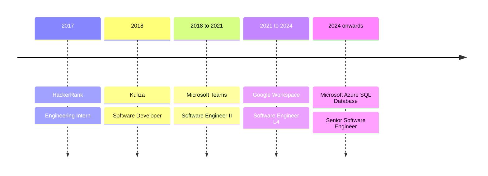

<h1 align="center">Hi, I'm Rishabh Jain</h1>

  <b>Senior Software Engineer</b> building large-scale distributed systems that serve hundreds of millions of users. 
  I am now building AI systems for real-world problems at scale.

  
  
  
  

  
  
  

| 8+ years | 2.1B+ | 250M+ | 50B+ |
| :---: | :---: | :---: | :---: |
| of engineering experience | events per day | users served | documents |

## About me

- I have 8+ years of experience across **Microsoft Azure SQL**, **Microsoft Teams** and **Google Workspace**.
- I specialise in distributed systems, reliability engineering, failovers, resource governance, CPU and NUMA allocation, performance optimisation and encrypted document pipelines.
- I am studying **Machine Learning and AI** through an MS at Liverpool John Moores University and an Executive Diploma at IIIT Bangalore.
- I am based in New Delhi, India.

## Experience

<b>Microsoft</b> · Senior Software Engineer, Azure SQL Database · 2024 to present

- Optimise resource usage through differential overbooking and NUMA-aware CPU allocation.
- Own failover KPIs, with bi-weekly reporting to leadership.
- Lead migrations from Logical Master to Transparent Serverless across regions.
- Improve failover telemetry used across about 10 on-call rotations.

`C#` `.NET` `Azure SQL` `Kusto` `Resource governance`

<b>Google</b> · Software Engineer L4, Encrypted Editors (Docs, Sheets and Slides) · 2021 to 2024

- Led 7 engineers to reach 100% encrypted Sheets import fidelity and 99.99%+ export reliability across 50B+ documents.
- Designed encrypted imports for Excel, Office binary and Word formats.
- Implemented encrypted Takeout for global wipeout compliance.
- Conducted 50+ interviews and mentored engineers.

`Java` `Web Workers` `Spanner` `Encryption`

<b>Microsoft</b> · Software Engineer II, Microsoft Teams · 2018 to 2021

- Scaled notifications to 2.1B daily events as Teams grew from 5M to 250M users.
- Reduced partner network calls by 60%.
- Added customer-level encryption, stale caching and data-driven retry policies.
- Built reaction, shared and priority notifications, with email click-through analytics.

`.NET Framework` `.NET Core` `Azure Storage` `Redis` `BCDR`

<b>Kuliza</b> · Software Developer, HDFC Brandsite and CMS · 2018

- Implemented async caching, role-based access control, and lead generation and aggregation workflows.

<b>HackerRank</b> · Engineering Intern · 2017

- Developed SQL, algorithm and regex challenges used in large-scale hiring assessments.

## Tech stack

**Languages**

**AI and machine learning**

**Storage, frameworks and platforms**

-0078D4?style=flat-square)

**Distributed systems:** resource governance, failovers and reliability, CPU and NUMA allocation, BCDR, encryption pipelines.

## Featured projects

| Project | What it does | Stack | Year |
| --- | --- | --- | :---: |
| [Legal Document RAG](https://github.com/rishabhjain9196/legal-document-rag) | Answers questions over 644 legal contracts, routing each question to its contract and citing the supporting clauses. | Python, LangChain, Chroma, OpenAI, Ragas | 2026 |
| [SmartMeetings](https://github.com/rishabhjain9196/SmartMeetings) | Turns recorded meeting audio into transcripts, summaries, tasks and engagement stats. Team project. | Android, Django REST, spaCy | 2019 |
| [Bear State Coffee API](https://github.com/rishabhjain9196/bearstatecoffee-backend) | REST API for products, combos, carts, orders and subscriptions, with OAuth2 accounts. Team project. | Django REST, PostgreSQL | 2018 |
| [Bear State Coffee client](https://github.com/rishabhjain9196/bearstatecoffee-react) | React client for browsing products and combos, with account flows. Team project. | React, React Router | 2018 |
| [Anti Theft Boomerang](https://github.com/rishabhjain9196/AntiTheftBoomerang) | Android security app with SMS commands, failed-unlock camera capture and low-battery location alerts. | Android, Java, Firebase | 2016 |
| [Networks Project](https://github.com/rishabhjain9196/NetworksProject) | NS2 simulations with AWK analysis of throughput, delay, jitter and packet loss. | Tcl, AWK, NS2 | 2017 |
| [Chess](https://github.com/rishabhjain9196/Chess) | Object-oriented console chess game for two players. | C#, .NET | 2020 |
| [Private Code Challenge Contest](https://github.com/rishabhjain9196/Private-Code-Challenge-Contest) | Web app for creating private coding contests and managing invitations. | Flask, MongoDB | 2017 |
| [Competitive Programming](https://github.com/rishabhjain9196/Competitive-Programming) | 254 C++ solutions from CodeChef, ACM-ICPC, SPOJ and other contests. | C++ | 2016 |
| [Star Messenger](https://github.com/rishabhjain9196/Star-Messenger) | Menu-driven terminal messenger with contacts, chats and notifications. Team project. | Shell | 2017 |
| [Graphical Calendar](https://github.com/rishabhjain9196/GraphicalCalendar) | Interactive calendar with keyboard navigation and BGI graphics. Team project. | C | 2017 |

**More projects and research**

- **Bi-modal emotion recognition:** Audio-visual emotion detection with CNNs, Keras, TensorFlow, Dlib and PyAudioAnalysis. Major project at JIIT, 2017.
- **Demand-supply workforce heatmaps:** ML-based demand-supply prediction for moving workers in consumer-producer apps. [Zomato Hackathon](https://github.com/rishabhjain9196/ZomatoHack---Throttling-Error), 2019.
- **ConMan:** Stale-configuration detection and drift prevention to improve reliability and on-call debugging. Microsoft Hackathon 2025.
- **Exploratory data analysis:** NYC taxi operations and traffic collision hotspots, using Python, Pandas, Matplotlib and Seaborn.
- **Writing:** [Key-value database internals](https://medium.com/swlh/key-value-pair-database-internals-18f52c36bb70), published in The Startup on Medium.

## Education

| Programme | Institution | Years |
| --- | --- | :---: |
| MS in Machine Learning and AI | Liverpool John Moores University | 2025 to present |
| Executive Diploma in Machine Learning and AI | IIIT Bangalore | 2025 to present |
| B.Tech (Honours) in Computer Science | Jaypee Institute of Information Technology, Noida | 2014 to 2018 |

- Graduated with a CGPA of 8.9/10 and received the Best Outstanding Student award.

## Mentorship

| 100+ | 15+ | 100s |
| :---: | :---: | :---: |
| hours devoted | mentees | mock interviews |

- I mentor engineers through Scaler Academy, 10xAcademy and other platforms.
- I help with interview preparation, system design, distributed systems, microservices, backend development and DSA.
- Mentees have joined Amazon, Google, Microsoft, ThoughtWorks, Airbus, Barracuda Networks, Genesis Global and Cybage Software.

## Awards and recognition

| Award | Details |
| --- | --- |
| Google Cloud Tech Impact Award | 2022, for the client-side encryption project. |
| Google Grungy Awards (3+) | For tackling unglamorous but critical tech debt, infrastructure fixes and reliability improvements. |
| Zomato Hackathon, 3rd place | 2019, for a demand-supply ML heatmap prediction engine. |
| ICPC Amritapuri, 97th | 2017. |
| Algofuzz 16.3, 2nd place | HackerEarth. |
| Encode 16.1, 3rd place | HackerRank. |
| Knuth Cup, 3rd place | 2017. |
| Execute 17.1, 2nd place | Competitive programming. |
